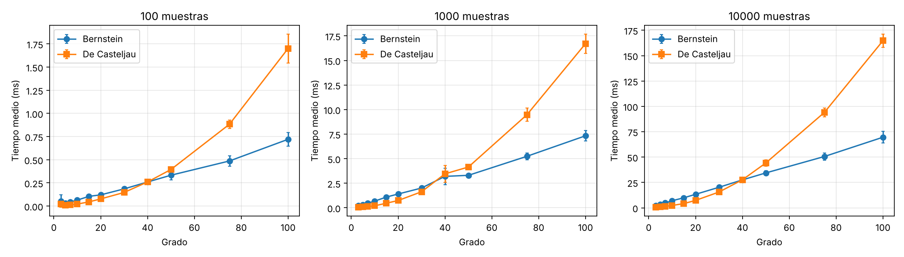
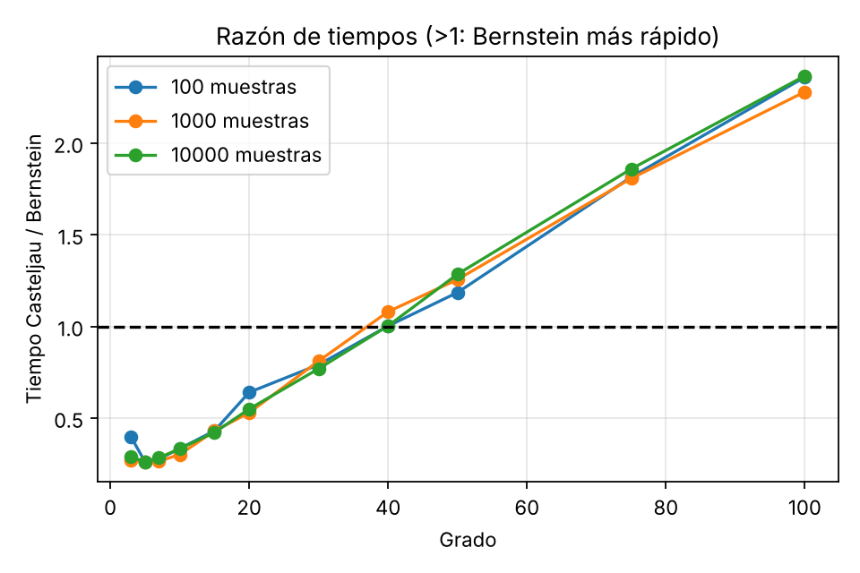
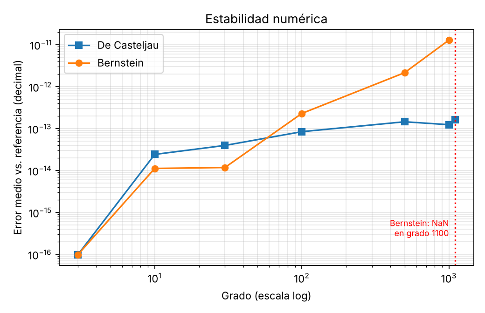

# Secciones de Sebastián Criollo: Objetivos, Experimentación y Análisis de resultados

Datos: `docs/informe/datos/comparacion-20261126-085323.csv` y `estabilidad-20261126-085323.csv`.
Figuras: `docs/informe/figuras/`. Para regenerarlas: `python generar_figuras.py` dentro de `docs/informe/datos/`.

## Objetivos

**Objetivo general.** Comparar la evaluación directa de curvas de Bézier mediante polinomios de Bernstein con el algoritmo de De Casteljau, en eficiencia y estabilidad numérica, para responder cuál resulta más conveniente según el grado de la curva.

**Objetivos específicos**

- Implementar ambos métodos en C# sin funciones gráficas que generen curvas (solo `DrawLine` entre puntos calculados).
- Medir con `Stopwatch` el tiempo de evaluación de cada método, sin incluir el dibujo, con 10 repeticiones por prueba, variando el grado y el número de muestras.
- Calcular la diferencia numérica entre los puntos generados por ambos métodos.
- Medir el error de cada método contra una referencia de alta precisión (`decimal`, 28 dígitos) para grados de 3 a 1100.
- Contrastar los resultados con la complejidad teórica: O(n) por punto en Bernstein y O(n²) en De Casteljau.

## Experimentación

Se ejecutaron dos escenarios con el proyecto `BezierApp.Benchmark` (.NET Framework 4.8, compilación Release, ejecutado sin depurador).

**Escenario 1: rendimiento.** Puntos de control generados de forma determinista (semilla 20261126). Cada prueba se repite 10 veces tras 3 corridas de calentamiento y no incluye el tiempo de dibujo. Se reporta media, desviación estándar, mínimo y máximo.

| Parámetro | Valores |
| --- | --- |
| Grado de la curva | 3, 5, 7, 10, 15, 20, 30, 40, 50, 75, 100 |
| Muestras por curva | 100, 1000, 10000 |
| Repeticiones | 10 (más 3 de calentamiento) |
| Métrica adicional | Diferencia máxima y media entre los puntos de ambos métodos |

**Escenario 2: estabilidad numérica.** Se compara cada método contra De Casteljau calculado en `System.Decimal` (28 dígitos). Los puntos de control son enteros (x = 10·i, y aleatoria entera en 0–500) y los valores de t son potencias exactas de 2 (0, 2⁻²⁰, 2⁻¹⁰, 0.5, 1−2⁻¹⁰, 1−2⁻²⁰, 1), de modo que las entradas son exactas en `double` y en `decimal`. El error se calcula con aritmética entera exacta (`BigInteger`) como distancia euclidiana a la referencia.

| Parámetro | Valores |
| --- | --- |
| Grado | 3, 10, 30, 100, 500, 1000, 1100 |
| Semillas | 20261126, 11, 22, 33, 44 |
| Valores de t | 7 por curva |

**Validación previa.** El núcleo se verificó con el cálculo manual de una cúbica en t = 0, 0.25, 0.5, 0.75 y 1 (`docs/calculos-manuales/validacion.md`), que coincide con ambas implementaciones.

## Análisis de resultados

De Casteljau es más rápido hasta el grado 30 y Bernstein lo supera desde el grado 40; en precisión, Bernstein es algo mejor entre los grados 10 y 30, De Casteljau gana desde el grado 100 y es el único que funciona a grado 1100.

### Rendimiento

La razón es tiempo de De Casteljau dividido entre tiempo de Bernstein: menor que 1 favorece a De Casteljau y mayor que 1 a Bernstein. Tiempos medios (ms) con 1000 muestras, 10 repeticiones:

| Grado | Bernstein (ms) | Desv. | De Casteljau (ms) | Desv. | Razón |
| --- | --- | --- | --- | --- | --- |
| 3 | 0.230 | 0.044 | 0.063 | 0.010 | 0.27 |
| 5 | 0.320 | 0.004 | 0.083 | 0.003 | 0.26 |
| 7 | 0.472 | 0.071 | 0.125 | 0.005 | 0.26 |
| 10 | 0.683 | 0.063 | 0.205 | 0.026 | 0.30 |
| 15 | 1.096 | 0.058 | 0.470 | 0.046 | 0.43 |
| 20 | 1.405 | 0.134 | 0.743 | 0.075 | 0.53 |
| 30 | 2.014 | 0.093 | 1.634 | 0.153 | 0.81 |
| 40 | 3.201 | 0.838 | 3.459 | 0.869 | 1.08 |
| 50 | 3.306 | 0.122 | 4.152 | 0.162 | 1.26 |
| 75 | 5.245 | 0.349 | 9.480 | 0.668 | 1.81 |
| 100 | 7.331 | 0.544 | 16.711 | 0.980 | 2.28 |

El cruce ocurre en el grado 40 con 100, 1000 y 10000 muestras, así que no depende del número de muestras. Con 10000 muestras el grado 100 tarda 69.6 ms en Bernstein y 164.7 ms en De Casteljau. El tiempo crece de forma lineal con las muestras en ambos métodos.

*Figura 1. Tiempo medio de evaluación según el grado (barras: desviación estándar).*

*Figura 2. Razón de tiempos; el cruce en 1 ocurre en el grado 40.*

Esto concuerda con la teoría: De Casteljau es O(n²) por punto y Bernstein O(n), por lo que a grados altos domina el término cuadrático. A grados bajos Bernstein carga un costo fijo mayor (potencias de t y 1−t, y coeficientes binomiales), y De Casteljau solo hace interpolaciones lineales. La diferencia entre los puntos de ambos métodos fue como máximo 3.5×10⁻¹² en grado 100, es decir, despreciable a escala de pantalla.

### Estabilidad numérica

Error medio y máximo contra la referencia de 28 dígitos, promediado sobre 5 semillas y 7 valores de t:

| Grado | Error medio Bernstein | Error medio De Casteljau | Máx. Bernstein | Máx. De Casteljau | Mejor |
| --- | --- | --- | --- | --- | --- |
| 3 | 9.8×10⁻¹⁷ | 9.8×10⁻¹⁷ | 6.0×10⁻¹⁶ | 6.0×10⁻¹⁶ | Igual |
| 10 | 1.1×10⁻¹⁴ | 2.4×10⁻¹⁴ | 5.9×10⁻¹⁴ | 1.6×10⁻¹³ | Bernstein |
| 30 | 1.2×10⁻¹⁴ | 4.0×10⁻¹⁴ | 8.3×10⁻¹⁴ | 3.2×10⁻¹³ | Bernstein |
| 100 | 2.3×10⁻¹³ | 8.4×10⁻¹⁴ | 7.8×10⁻¹³ | 2.5×10⁻¹³ | De Casteljau |
| 500 | 2.2×10⁻¹² | 1.5×10⁻¹³ | 5.5×10⁻¹² | 9.8×10⁻¹³ | De Casteljau (15×) |
| 1000 | 1.3×10⁻¹¹ | 1.2×10⁻¹³ | 3.6×10⁻¹¹ | 5.6×10⁻¹³ | De Casteljau (104×) |
| 1100 | NaN | 1.6×10⁻¹³ | NaN | 1.5×10⁻¹² | Solo De Casteljau |

*Figura 3. Error medio contra la referencia de 28 dígitos (escala logarítmica).*

El error de De Casteljau se mantiene alrededor de 10⁻¹³ en cualquier grado, porque solo usa combinaciones convexas (pesos t y 1−t, ambos no negativos). El de Bernstein crece con el grado, sobre todo en t = 0.5 y cerca de t = 1, porque suma términos con coeficientes binomiales enormes cuyo redondeo se acumula. A grado 1100 el coeficiente binomial se desborda a infinito y Bernstein devuelve NaN en todos los t interiores.

### Limitaciones

- Las semillas solo varían la coordenada Y; la X es fija (x = 10·i), por eso las 5 semillas dan resultados parecidos.
- En t = 0 y t = 1 ambos métodos devuelven exactamente el primer y último punto de control, por lo que su error es 0 en esos valores.
- Los errores absolutos son muy pequeños (menos de 4×10⁻¹¹ sobre coordenadas del orden de miles). La diferencia práctica solo importa en cálculos que encadenen muchas operaciones o en grados muy altos.
- Los tiempos dependen de la máquina; se reportan para una laptop con .NET Framework 4.8 en Release.

### Respuesta a la pregunta de investigación

¿Qué método es más eficiente y estable? Depende del grado:

| Rango de grado | Más eficiente | Más estable |
| --- | --- | --- |
| ≤ 30 (uso típico en gráficos) | De Casteljau (hasta 4 veces) | Bernstein, por margen mínimo (~10⁻¹⁴) |
| 40 a 100 | Bernstein (hasta 2.4 veces) | De Casteljau desde ~100 |
| > 100 | Bernstein, si es válido | De Casteljau (hasta 104× a grado 1000) |
| ≥ ~1030 | Solo De Casteljau | Solo De Casteljau |

Para curvas de uso normal, De Casteljau es la mejor opción: más rápido, con precisión equivalente y, además, permite visualizar las interpolaciones intermedias. Bernstein solo compensa en grados medios (40 a 100) si el rendimiento es crítico, y no es utilizable en grados muy altos.
